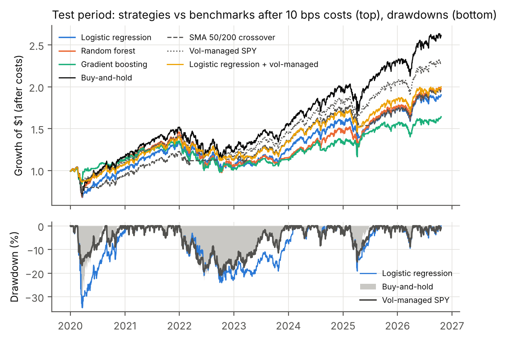

# Can machine learning time the market?

Code, data and outputs for my FI4008 (Machine Learning in Finance, University of Aberdeen) individual assessment.

Three classifiers (logistic regression, random forest, gradient boosting) predict whether **SPY** (the S&P 500 ETF) will rise from today's close to tomorrow's close, using 37 predictors that are all known at today's close. The strategy holds SPY when the model predicts "up" and 3-month T-bills otherwise. It is backtested out of sample (2020 to 2026) after 10 bps transaction costs, against buy-and-hold, a 50/200-day moving-average crossover and volatility-managed SPY.

**Main finding:** none of the models beats buy-and-hold after costs. Accuracy is below an "always up" forecast, and ROC-AUC is about 0.5. The model with the best ranking ability (gradient boosting) has the best Sharpe ratio before costs but the worst after costs, because it trades about 64 times a year.

## Headline results (test period, Jan 2020 to Oct 2026, after 10 bps costs)

| Strategy | Accuracy | ROC-AUC | Ann. return | Sharpe | Max drawdown | Turnover (x/yr) |
|---|---|---|---|---|---|---|
| Logistic regression | 0.542 | 0.503 | 9.95% | 0.44 | -34.6% | 17.0 |
| Random forest | 0.535 | 0.512 | 10.58% | 0.48 | -34.6% | 27.0 |
| Gradient boosting | 0.531 | 0.524 | 7.59% | 0.34 | -27.7% | 64.1 |
| Buy-and-hold | 0.547 (always "up") | 0.500 | 15.22% | 0.66 | -33.7% | 0.15 |
| SMA 50/200 crossover | | | 10.44% | 0.50 | -33.7% | 1.0 |
| Vol-managed SPY | | | 13.08% | 0.72 | -21.0% | 2.45 |

Sharpe ratios use the 3-month T-bill as the risk-free rate (average 2.97% over the test period). The full tables are in `tables/` (T17 and T19).



## How to reproduce

```
pip install -r requirements.txt     # Python 3.12 or later (I used 3.13)
python main.py                      # about 10 minutes
```

`main.py` runs `data.py`, `features.py`, `models.py`, `backtest.py`, `evaluation.py` and `plots.py` in order. It rebuilds `tables/` (30 CSV files), `figures/` (13 PNG files) and `data/processed/` from the cached raw data. With the pinned versions in `requirements.txt` the rebuilt tables are identical to the ones in this repository. The random seed is 42 throughout.

`notebooks/FI4008_analysis.ipynb` runs `main.py` and then displays the key tables and figures.

| File | What it does |
|---|---|
| `main.py` | Runs every step in order and prints the checks |
| `data.py` | Loads the raw data, checks the SHA-256 hashes, cleans it, descriptive statistics |
| `features.py` | Target and 37 predictors, plus the truncation and target-alignment tests |
| `models.py` | The three model pipelines, time-series tuning and walk-forward predictions |
| `backtest.py` | Trading rule, transaction costs, benchmarks and robustness variants |
| `evaluation.py` | Prediction metrics, significance tests, placebo and positive-control checks, deflated Sharpe ratio |
| `plots.py` | All 13 figures |
| `download_data.py` | How the raw data was downloaded (documentation only; see below) |

## Data

Daily data from 3 January 2005 to 21 October 2026, downloaded on 22 October 2026 and cached in `data/raw/`:

- **Yahoo Finance** (via `yfinance`): SPY, nine Select Sector SPDR ETFs (plus XLC and XLRE, used only in the descriptive statistics), and the VIX index.
- **FRED** (Federal Reserve Bank of St. Louis): 3-month, 2-year and 10-year Treasury yields, and the 10y-2y and 10y-3m spreads.

`data/raw/metadata.json` records the sources, download settings and a SHA-256 hash for each file. `main.py` stops if any file has changed. Rerunning `download_data.py` would overwrite the cache with today's data, which will not match exactly (adjusted prices change as new dividends are paid), so the analysis only ever reads the cached files.

## How look-ahead bias and leakage are prevented

- Every predictor for day t uses data up to the close of day t only (`shift(k)` with k ≥ 0 and trailing windows). The VIX and Treasury yields are lagged one extra day, because the VIX settles after SPY closes and FRED yields are published the next business day.
- A **truncation test** rebuilds all predictors using only data up to 14 check dates and confirms that nothing changes. A **target-alignment test** confirms the target on day t is the return from t to t+1.
- Missing values are forward-filled (at most 5 days) and never back-filled. Warm-up rows for the longest rolling window are dropped.
- The split is chronological: training 2006 to 2016, validation 2017 to 2019 and test 2020 to 2026. There is no shuffling anywhere.
- Hyperparameters are tuned on the training years only, with `TimeSeriesSplit` (5 folds, 5-day gap). Winsorising and scaling sit inside the scikit-learn `Pipeline`, so they are fitted on training folds only.
- Validation and test predictions are made walk-forward: each January the models are refitted on all earlier data (with the last day purged) and predict the coming year only.
- The candidate strategy was chosen on the validation period, and the test period was run once.
- A **placebo** check (shuffled labels give ROC-AUC ≈ 0.5) and a **positive control** (a deliberately leaked predictor gives ROC-AUC 0.99) show that the validation procedure can tell real signal from none.

## Trading rule and costs

At the close of day t the strategy holds SPY for the next day if P(up) > 0.5, otherwise T-bills:

```
R(t+1) = w(t) * SPY return(t+1) + (1 - w(t)) * T-bill(t) - 0.001 * |w(t) - w(t-1)|
```

Costs are 10 bps per unit traded, including the first entry. Sensitivity results for 0, 5 and 20 bps, plus long/short, one-day-delay and 5-day-horizon variants, are in `tables/T22_cost_sensitivity.csv` and `tables/T23_variants.csv`.

## Output files

Files in `tables/` and `figures/` are prefixed T01 to T26 and F01 to F13. `tables/run_log.txt` is the console output of a full run.
